# How TenancyDesk works

For the developer who has to maintain this. If you only want to use the app, read
[USING-THE-APP.md](USING-THE-APP.md) instead.

---

## The shape of it

One Node process. One SQLite file. One HTML page. No build step, no bundler, no
`dist/`, no database server, no message queue.

| Piece | Where | Notes |
| --- | --- | --- |
| Entry point | `src/server.ts` | Reads config, loads templates, opens the database, starts Fastify |
| HTTP surface | `src/app.ts` | Every route, in one file, in the order you would look for them |
| Documents | `src/docs/` | Template loading, expansion, Markdown parsing, Word/HTML writing, checks |
| Back office | `src/backoffice/` | Landlords, properties, rooms, tenants; the prefill layers and how they merge |
| Assistant | `src/agent/` | DeepSeek client, tool definitions, the loop, prompt |
| Rules | `src/knowledge/rules.ts` | 21 curated England & Wales rules with sources |
| Interface | `public/` | `index.html`, `app.js`, `styles.css` — plain ES modules, served statically |
| Tests | `tests/` | 251 tests on `node:test` |

Three runtime dependencies: `fastify`, `@fastify/static`, `docx`.

There is no build step because **Node 24 runs the TypeScript directly** (type
stripping). That imposes two rules on the source, both enforced by `tsconfig.json`:

- `erasableSyntaxOnly` — no enums, no parameter properties, no namespaces. Only
  syntax that can be deleted without changing behaviour.
- `verbatimModuleSyntax` with explicit `.ts` import extensions.

`pnpm typecheck` runs `tsc --noEmit` for the type safety that stripping does not
give you at runtime.

---

## Request flow

```mermaid
graph TD
    A[Browser<br/>public/app.js] -->|JSON + SSE| B[Fastify<br/>src/app.ts]
    B --> C[Store<br/>src/db.ts<br/>packs.fields_json]
    B --> D[TemplateRegistry<br/>templates/*.md]
    D --> E[expand&#40;&#41;<br/>src/docs/template.ts]
    E --> F[parseMarkdown&#40;&#41;<br/>src/docs/markdown.ts]
    F --> G[renderDocx<br/>src/docs/toDocx.ts]
    F --> H[renderHtml<br/>src/docs/toHtml.ts]
    G --> I[data/documents/&lt;pack&gt;/*.docx]
    H --> J[data/documents/&lt;pack&gt;/*.html]
    E --> K[data/documents/&lt;pack&gt;/*.md]
    B --> L[DeepSeekClient<br/>src/agent/deepseek.ts]
    L --> M[runAgent<br/>src/agent/loop.ts]
    M --> N[executeTool<br/>src/agent/tools.ts]
    N --> C
    N --> D
    N --> O[runComplianceChecks<br/>src/docs/compliance.ts]
    N --> P[generateDocuments<br/>src/docs/generate.ts]
```



Plain-text version, because the diagram is the summary and this is the detail:

1. The browser holds one pack id. Every action is a request about that pack.
2. `app.ts` loads the pack from SQLite — `pack.fields` is a plain object such as
   `{ "landlord.full_name": "Priya Raman", "tenants": [{…}] }`.
3. To render a document, the registry supplies the template body, `expand()` fills
   it, `parseMarkdown()` turns it into blocks, and the two renderers write files
   into `data/documents/<pack-id>/`.
4. A `documents` row records the three paths. Downloads go through
   `GET /api/documents/:id/download`, which re-reads the file from disk.
5. The assistant takes a different route: `runAgent()` talks to DeepSeek, the model
   asks for tools, `executeTool()` runs ordinary code against the same `Store` the
   routes use, and results go back to the model. The browser sees each step as a
   server-sent event.

The important consequence: **the assistant and the user's mouse drive the same
functions**. There is no second, AI-only path that could produce different
documents.

---

## The document pipeline

### 1. Load

`TemplateRegistry.load('templates')` reads every `*.md` file and splits the YAML
front matter from the body with `splitFrontMatter()`. A deliberately tiny YAML
reader (`parseFrontMatter`) handles only `key: value`, quoted strings and inline
arrays `[a, b]` — anything richer is overkill and a dependency.

The loader also reports problems as warnings, surfaced at startup, on
`/api/health` and by `pnpm doctor`:

- an unknown placeholder (a key not in `FIELDS` and not `today`) — usually a typo,
  and the kind of typo that silently produces a blank in a contract;
- a duplicate `id`;
- a key in `required` that the body never uses.

### 2. Expand

`expand(body, values)` walks the template once to build a small tree (`text`,
`var`, `if`, `each`), then renders it against a scope stack.

Value lookup order in `resolve()`:

1. **Exact key match** in the innermost scope, then outwards. This is the common
   case: packs store `"landlord.full_name"` as a single flat key, so
   `{{landlord.full_name}}` matches it directly.
2. Only if that fails, split on dots and walk a real object — which is what
   `{{this.full_name}}` needs inside an `{{#each tenants}}`.

Getting this order backwards was a real bug during development: nested-only lookup
silently blanked every document.

Filters are applied after resolution (`money`, `date`, `dateordinal`, `dateshort`,
`upper`, `lower`, `title`, `number`). An unknown filter **throws** rather than
returning empty, because a blank line in a tenancy agreement is worse than a
visible failure.

Conditions go through `parseCondition()`, which supports presence, `!negation`,
`==` and `!=`. This exists because select fields hold words: `"No"` is a non-empty
string, so a naive `{{#if pets_allowed}}` renders the "pets permitted" branch when
pets are forbidden. In a legal document that is not a cosmetic bug.

### 3. Parse

`parseMarkdown()` produces a small block AST — headings, paragraphs, bullets,
numbered items, tables, callouts, rules and page breaks. It is not CommonMark and
will never grow to be. Allowing an unbounded Markdown subset in legal templates
means a template author can hit a construct that renders unpredictably; a
documented subset can be tested exhaustively.

Two strictness choices, both worth keeping:

- a blank line ends a table;
- `| --- |` is required for a table to be recognised at all.

### 4. Render twice

`renderDocx()` builds the Word file with the `docx` package. A4, 2 cm margins,
Georgia, a running header with the document title and a footer with the agency name
and "Page X of Y".

`renderHtml()` builds a stand-alone page: embedded CSS, `@page { size: A4 }`, and a
toolbar with a **Print / Save as PDF** button that hides itself when printing.

**Why HTML for PDF?** The alternatives are a headless Chrome (~300 MB) or
LibreOffice (~700 MB), both of which would turn a one-command install into a
project. Every browser already has a print-to-PDF dialog that produces a better
result than a naive PDF library would. The cost is that producing a PDF requires a
human to press Print — acceptable for a tool used a few times a week, and it keeps
the Docker image small.

The `.md` output is the expanded source, unparsed. It exists so a document can be
checked word by word without opening Word.

---

## The agent loop

`runAgent()` in `src/agent/loop.ts`:

1. Build the system prompt (`buildSystemPrompt`) — role, the current pack
   reference, the whole field catalogue with types and options, and the eight
   non-negotiable rules.
2. Send messages plus the eight tool definitions to `DeepSeekClient.chat()`.
3. If the model returns no tool calls, that is the answer — stop.
4. Otherwise append the assistant message, execute each tool call in order, and
   append each result as a `tool` message. Repeat.
5. Stop after 8 rounds. Stop early if the same call (name + arguments) has been
   attempted more than three times, which is the signature of a stuck model.
6. Save the run — steps, token counts, final summary — to `agent_runs`.

Tool results are fed back as JSON, truncated at 12,000 characters. Tool arguments
that fail to parse, name an unknown tool, or throw inside `executeTool` are returned
to the model as `{ "error": "..." }` so it can correct itself rather than the whole
turn collapsing.

Every step is emitted to the browser as an SSE event (`start`, `tool`,
`tool_result`, `message`, `usage`, `done`, `error`, `fatal`). The user watching
"Recording 6 details" is not decoration — it is the audit trail, live.

### The safety split

This is the central design decision, and it is structural rather than prompt-based:

| The model decides | The code decides |
| --- | --- |
| Which fields to fill, and with what values | Which field keys exist at all |
| When to run checks | What the checks are |
| Which documents to generate | What the documents say |
| What to tell the user | Whether generation is permitted |

`set_fields` runs every key through `normaliseFields()`, which **drops any key not
in `FIELDS`**. A model that hallucinates a `special_clause` field has nowhere to put
it. `generate_documents` re-runs the compliance checks and refuses while any error
remains. `executeTool` has no tool that can edit a template.

So the worst a confused model can do is put a wrong value in a real field — which
is visible in the Details tab and in the streamed step log, and correctable. It
cannot invent a clause, and it cannot produce a document that the checks reject.

---

## The data model

Three tables in `src/db.ts`:

```
packs          id, reference, tenant_name, property_address, status,
               fields_json, notes_json, cover_message_json, created_at, updated_at
documents      id, pack_id → packs.id, template_id, title,
               docx_path, html_path, md_path, checksum, byte_size, generated_at
agent_runs     id, pack_id → packs.id, kind, model, prompt_tokens,
               completion_tokens, steps_json, summary, created_at
```

**Why `fields_json` and not a normalised table?** A pack's fields are an open,
versioned dictionary that the templates define. Normalising them means a migration
every time a document needs a new detail, and a join for every render. The JSON
column means adding a field to `src/docs/fields.ts` is the whole change. The cost is
that you cannot query "all packs in Manchester" in SQL — which a single-user tool
with tens of packs does not need.

`tenant_name` and `property_address` are denormalised onto `packs` purely so the
sidebar can list packs without parsing every JSON blob.

`documents` rows point at files; the files are the truth. Regenerating a document
deletes the previous row for that `template_id` and writes a new one, so a pack has
at most one current version of each document. Old files on disk are left in place —
cheap, and occasionally useful.

`agent_runs` exists so that "what did the assistant actually do?" has an answer
that does not depend on the browser tab still being open.

Document paths are stored relative to `DATA_DIR` and resolved on read with a
`resolve()`-then-prefix-check in `src/app.ts`, so a tampered path cannot escape the
data directory.

---

## Design decisions and trade-offs

| Decision | Why | What it costs |
| --- | --- | --- |
| SQLite via `node:sqlite` | Built into Node; no native module to compile, no server to run, one file to back up | Single writer; fine for one user, wrong for a team |
| DOCX + print-to-HTML, no PDF library | Keeps install to one command and the image small | Making a PDF needs a human to press Print |
| Vanilla front end, no framework | Nothing to build, nothing to keep updated, works for years untouched | More manual DOM code; no reactive state management |
| Markdown subset as the template format | A letting agent can edit it in Notepad and see the result | No images, no hyperlinks, no nested lists |
| Deterministic compliance checks | The same arithmetic runs for the assistant and the user, and can be tested | Rules must be maintained by hand as the law changes |
| Curated rule set instead of model memory | Language models misremember law confidently; rules carry sources | The set is only as good as its last review date |
| Model fills fields, never clauses | A hallucination cannot become a contract term | The assistant cannot help with novel wording — that is a template edit |
| No auth | It is a personal tool, not a service | Must sit behind a VPN or authenticating proxy; see [SECURITY.md](../SECURITY.md) |
| No build step | One `git clone`, one `pnpm install`, one `pnpm start` | Node 24+ required; source must stay "erasable" TypeScript |
| SSE rather than WebSockets | One-directional stream, no extra dependency, works through proxies | No server→client messages outside a request |

---

## What to change where

| Task | File |
| --- | --- |
| Change a document's wording | `templates/*.md` |
| Add a document type | new `templates/*.md` with `id`, `title`, `category`, `required` |
| Collect a new detail | `src/docs/fields.ts` (one entry in the right group) |
| Change which documents move-in selects | `TemplateRegistry.suggestSelection` in `src/docs/registry.ts` |
| Change a compliance check | `src/docs/compliance.ts` |
| Change what a rule says, or add one | `src/knowledge/rules.ts`, then `pnpm rules` |
| Add or change an assistant tool | `src/agent/tools.ts` (`TOOL_DEFINITIONS`, `executeTool`, `describeToolCall`, `summarise` in `loop.ts`) |
| Change the assistant's behaviour | `src/agent/prompts.ts` |
| Change retries, temperature or token limits | `src/agent/deepseek.ts` |
| Change Word styling, fonts, margins | `src/docs/toDocx.ts` |
| Change the printed/PDF look | `CSS` in `src/docs/toHtml.ts` |
| Add or change an endpoint | `src/app.ts` |
| Change the interface | `public/app.js`, `public/styles.css` |
| Change the ZIP contents sheet | `src/docs/packSummary.ts` |
| Change when the app asks before generating | `src/docs/gate.ts` |
| Change which deadlines appear, or how they are gathered | `src/backoffice/due.ts` |
| Change the calendar export | `src/util/ics.ts` |
| Change what the backup contains | `src/backoffice/backup.ts` |
| Change the printable history | `src/docs/timeline.ts` |
| Record a template change on purpose | `pnpm golden` |
| Change what the audit flags | `src/docs/templateAudit.ts` |
| Change how a document's values are substituted | `src/docs/docxFill.ts` |
| Change how a value is formatted (`£1,450`, `1 November 2026`) | `formatLike()` in `src/docs/docxFill.ts` |
| Change the derived first payment date | `paymentDateFor()` in `src/docs/fields.ts` |
| Change what a tenancy inherits | `src/backoffice/inheritance.ts` |
| Add a back-office record type | `src/backoffice/entities.ts` |
| Change how existing packs are migrated | `src/backoffice/migrate.ts` |
| Change how an uploaded document's values are recognised | `src/docs/linkProposal.ts` |
| Change where uploads are stored | `src/backoffice/customTemplates.ts` |
| Change environment variables | `src/config.ts` **and** `.env.example` |

After changing anything in `src/docs/` or `templates/`, run `pnpm sample` — it
renders every document with a complete fictional pack, which catches most breakage
faster than reading the diff. After changing anything a document describes, run
`pnpm docs:check`.

---

## Using an agency's own document

Two modules sit behind the "use our document, not yours" feature. Neither is wired
into the interface yet; both are finished and tested.

**`src/docs/templateAudit.ts` — is their document still lawful?**
`auditDocumentText(text)` is pattern matching, not a model, so the same document
always gives the same answer. It flags an agreement that still calls itself an
assured shorthold tenancy, refers to section 21 or section 19A, creates a fixed
term, or reviews rent by "a reasonable percentage". It understands negation —
"section 21 is abolished" is not a problem — and scope-checks the absence rules, so
a deposit form is not asked why it has no pets clause.

**`src/docs/docxFill.ts` — substitute values, keep everything else.**
A `.docx` is a ZIP of XML, so `readZip()` opens it, `replaceInDocumentXml()`
rewrites the paragraphs that contain a value, and `createZip()` closes it again.

Three details make this work in practice:

1. **Word splits sentences into runs.** `£980` may be `£9` in one `<w:t>` and `80` in
   another. The code rebuilds each paragraph's plain text, finds the value there,
   then maps the edit back onto the real runs, keeping the first run's formatting
   and adding `xml:space="preserve"` where spaces matter.
2. **The new value follows the document's own style.** `formatLike()` turns `1450`
   into `£1,450` when the original said `£980`, and `2026-11-01` into
   `1 November 2026`, `1st November 2026` or `01/11/2026` to match the sample.
3. **The same old value can appear in two places.** A tenancy starting 1 November
   and an inventory agreed that day both read `30 October 2026` in last year's
   paperwork. A `near` hint restricts a substitution to the paragraph containing
   identifying words, and targeted links are applied before general ones.

Values that are not found are reported, never silently dropped. `pnpm demo:fill`
exercises the whole path with a document shaped like a letting agency's.

---

## Testing

`node:test`, no test framework dependency. `pnpm test` runs
`node --test --test-isolation=none "tests/*.test.ts"`.

| File | Covers |
| --- | --- |
| `template.test.ts` | Expansion, filters, conditions, comparisons, front matter, placeholder discovery |
| `markdown.test.ts` | Block parsing, inline emphasis, the empty-bold-placeholder case |
| `docs.test.ts` | Compliance arithmetic and deadlines, field normalisation and merging |
| `render.test.ts` | Registry loading and warnings, rendering, file generation, the store, the rule set |
| `api.test.ts` | Every route via `fastify.inject`, including the SSE stream and ZIP download |
| `agent.test.ts` | DeepSeek client (errors, retries, tool parsing), each tool, the loop, the prompt |
| `audit.test.ts` | The agreement audit, including a guard that every shipped templates pass it |
| `backoffice.test.ts` | Inheritance precedence and provenance, migration preview and apply, and a three-field tenancy rendering a real document |
| `gate.test.ts` | Relaxed mode never blocks and always asks; strict mode holds; only serious findings prompt |
| `docxFill.test.ts` | ZIP round trip, reading a `.docx`, substituting values across split runs, formatting preservation, and targeting an ambiguous value |
| `due.test.ts` | Gathering deadlines across tenancies, and the iCalendar output |
| `golden.test.ts` | The rendered text of every template is unchanged, unless it was changed on purpose |
| `backup.test.ts` | The archive's contents, and that the copied database opens and still holds the data |

Tests never touch the project's real `data/` folder — `tests/helpers.ts` hands out
temp directories. `--test-isolation=none` runs the files in one process, which is
faster and avoids spawning children; the suite is written to tolerate that.

The assistant is tested against a **scripted `fetch`**: `DeepSeekClient` accepts a
`fetchImpl`, and `buildApp` accepts an injected client. That means the whole loop —
tool calls, error feedback, repetition guard, SSE framing — is covered without a
network call or an API key. What is *not* covered is DeepSeek's live behaviour; see
the status table in the [README](../README.md#status-and-roadmap).

---

## Known limitations

- **Single user.** No accounts, no ownership, no locking. Two people on the same
  instance would edit the same packs.
- **No auth, by design.** It must run on a trusted machine or behind a VPN or
  authenticating proxy.
- **No email or e-signature.** It drafts a tenant message and produces a Word file;
  sending and signing are somebody else's job.
- **The rule set dates.** It was reviewed on the date shown in
  [RULES.md](RULES.md); Phase 2 and 3 of the Renters' Rights Act are still landing.
- **England & Wales only.** Scottish and Northern Irish tenancy law are different
  frameworks; do not reuse these templates there.
- **Chat history is per browser tab.** The conversation lives in memory in
  `public/app.js`; only the effects (fields, notes, documents, `agent_runs`) are
  persisted. Reloading loses the transcript, not the work.
- **Regenerating a document changes its `.docx` bytes**, because the Word writer
  stamps the current time into the file metadata. Content is stable; hashes are not.
