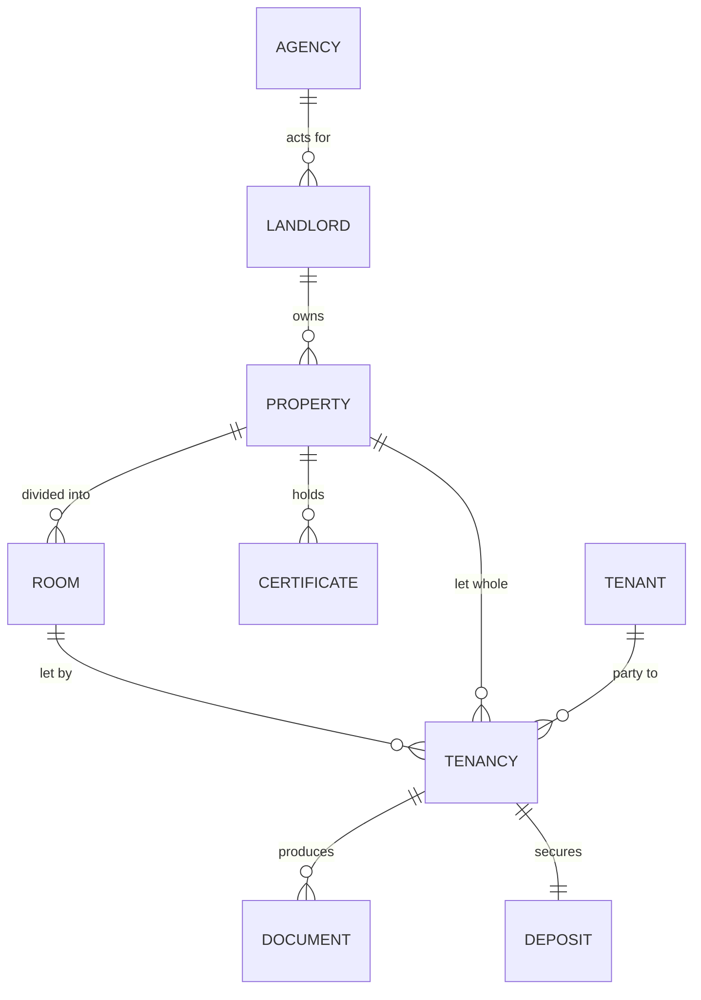

# Back office and prefilling

Why the app needs a back office, what it should hold, and how a new tenancy should
end up needing three typed details instead of forty.

This is a design note, not a description of what exists. For current status see the
[README](../README.md#status-and-roadmap); for sequencing see [ROADMAP.md](ROADMAP.md).

---

## The problem with the current shape

Today a **pack is an island**. Each one holds a flat dictionary of details, so for
every new tenant the agent retypes the property address, the landlord, the room, the
deposit scheme and the rent — details that have not changed since the last tenancy
at the same property, and often for years.

Two consequences:

1. The Details tab is long, and most of it is the same every time.
2. There is nowhere to look up "which tenancies are at this property?" or "which
   certificates expire this month?", because nothing is shared between packs.

A back office fixes both. It is not a nice-to-have: it is the difference between a
document generator and the agency's record of its lettings.

---

## The data model



| Entity | Holds | Set once per |
| --- | --- | --- |
| **Agency** | Name, address, phone, email, client money protection scheme, redress scheme, negotiator, rent account | The business |
| **Landlord** | Name, address, contact details | Client |
| **Property** | Address, postcode, council, EPC rating and reference, property type, furnished status | Address |
| **Room** | Room number, rent, deposit, status (let / void) | Room |
| **Certificate** | Gas safety, EICR, EPC, right to rent, alarms — each with issue date and expiry | Property |
| **Tenant** | Name, email, phone, date of birth, ID checked | Person |
| **Tenancy** | The link: room or property + tenant(s) + start date + status. **This is what we currently call a pack.** | Each letting |
| **Deposit** | Amount, scheme, scheme reference, received date, protected date | Each letting |

Everything the app already does — the assistant, the checks, the documents, the
deadlines — stays attached to the **Tenancy**. Nothing is thrown away; the tenancy
simply stops being the only thing that exists.

---

## The prefill chain

A detail is looked up in this order. The first layer that has a value wins.

| Layer | Entered | Feeds |
| --- | --- | --- |
| 1. Agency | once, in Settings | agency name, address, phone, email, CMP and redress schemes, negotiator, rent account |
| 2. Landlord | once per client | landlord name, address, contact |
| 3. Property | once per address | address lines, postcode, council, EPC, type, furnished |
| 4. Room | once per room | room number, rent, deposit |
| 5. Tenancy | per tenant | tenant name and email, start date, anything genuinely different |

### What this means in practice

Letting Room 2 of a house already set up, for a new tenant:

```
Typed:     tenant name · tenant email · tenancy start date          (3 fields)
Prefilled: house address · room number · rent · deposit · payment date
           rent due day · inventory date · agency details · landlord details
Derived:   written-statement deadline (+28 days) · deposit deadline (+30 days)
           · pack reference · document dates
```

That is the whole point of the exercise. The eight details the client listed by hand
shrink to three typed and five inherited, and the two statutory deadlines are
computed rather than remembered.

### Rules of inheritance

1. **A lower layer always wins.** A tenancy-specific rent beats the room's rent.
2. **Clearing a field at the tenancy level means "go back to inherited"**, not
   "blank". There is an explicit "override" marker.
3. **Every prefilled value says where it came from** — "from Room 2" or "from
   Property". Without that, an inherited error is invisible.
4. **Changing an inherited value asks about the tenancies that use it.** Editing
   the rent on a room with three active tenancies should say so, not silently
   change three agreements.

---

## Forms that follow their documents

The client asked for the form to follow **their** document formats rather than our
generic list. That is the right instinct, and it changes how the form is built.

Once a document is uploaded and its slots are mapped (see M1 in the
[ROADMAP](ROADMAP.md)), the app knows: which details that document actually contains,
and **in what order they appear**. The form is then generated from the document
rather than from the internal catalogue:

| | Today | Proposed |
| --- | --- | --- |
| Source of the fields | our 40-field catalogue | the document's mapped slots |
| Order | our grouping | the document's clause order |
| Extras | all of it, always | a fixed "compliance" section + a collapsed "everything else" |

Their room-only contract needs: house address, room number, rent, contract start
date, payment date, schedule-of-condition date, tenant name, tenant email. Eight
fields, in the order the contract asks for them — which is exactly the list they
sent by hand.

**Three sections, in this order:**

1. **This contract needs** — generated from the document, in document order, with
   inherited values shown as grey text and editable.
2. **Compliance records** — gas safety, EICR, right to rent, How to Rent, alarms.
   Not in their contract, but legally required, and they drive the deadlines.
3. **Everything else** — the full catalogue, collapsed, for the rare tenancy that
   needs it (guarantor, pets detail, special terms).

The compliance section is the one place we deliberately depart from "follow their
document": the documents do not record those dates, but the app must, or it cannot
warn anybody about anything.

---

## Screens

| Screen | Purpose |
| --- | --- |
| **Dashboard** | What needs doing now: deadlines in the next 30 days across every tenancy, certificates expiring, deposits unprotected, voids |
| **Tenancies** | The current pack list, with status: upcoming / active / ending / ended |
| **Properties** | One per address; opens to rooms, certificates, tenancies, landlord |
| **Tenants** | A searchable register with tenancy history — "what did we sign with this person, and when" |
| **Landlords** | Clients, and the properties and tenancies they own |
| **Settings** | Agency details, schemes, negotiator, document templates, API key status, backup, export |

Every screen reuses the same store; none of it is new data, only newly *shared* data.

---

## Migration of what already exists

There are already packs in `data/`. They must not be lost or corrupted.

- Derive properties and rooms from the distinct property addresses and room numbers
  already recorded.
- Derive landlords from the distinct landlord names and addresses.
- Derive tenants from the names and emails in each pack.
- **Show the result and ask for confirmation before writing it.** A migration that
  silently merges two "14 Beech Road" records is worse than no migration.
- The original pack stays intact; it simply gains a link to its property and room.

---

## What I would deliberately not build

- **Rent ledger, arrears, receipts.** Accounting is a solved problem with good cheap
  tools, and getting it wrong is worse than not doing it. See
  [TOOLBOX.md](TOOLBOX.md).
- **An applications pipeline** (viewing → referencing → offer). It is a different
  product, and it is where a small agency's process becomes bespoke.
- **Multi-user accounts and permissions.** Still a single-user tool.
- **Chasing the tenant.** No email, no SMS. It tells; the agent decides.

---

## Risks

| Risk | Mitigation |
| --- | --- |
| Migration merges or duplicates entities | Preview, confirm, and make it repeatable; never guess silently |
| Over-modelling — more structure than prefilling needs | The test for every entity: *does it remove typing, or answer a question the agent asks?* If neither, it does not go in |
| An inherited value is wrong and several tenancies inherit it | Show provenance on every prefilled field; ask before changing a shared value |
| Their portfolio includes property outside England & Wales | The app must say so plainly rather than generate a plausible-looking agreement. The screenshot already shows the assistant catching a Swedish address — this should also be a deterministic check |

---

## Open questions

1. **Is any of the portfolio outside England and Wales?** The screenshot shows
   `Hisinga Backa, 422 41` beside a Birmingham postcode, which looks like a Swedish
   address mixed into an English one. If they genuinely let abroad, the app must
   refuse to produce an E&W agreement rather than warn.
2. **Do they want the tenancy lifecycle managed** (upcoming → active → ending →
   ended, with the end-of-tenancy pack), or only the paperwork at the start?
3. **Certificates: per property or per room?** A gas certificate covers a whole
   house; an EICR usually too. Per property is the recommendation, with the room
   inheriting it.
4. **Should the register hold money at all** — deposits received and returned — or
   only the deposit scheme details needed for the prescribed information?
