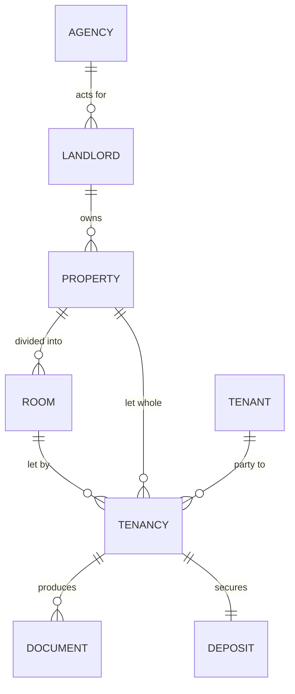

# Back office and prefilling

Why the app needs a back office, what it should hold, and how a new tenancy should
end up needing three typed details instead of forty.

This is a design note, not a description of what exists. For current status see the
[README](../README.md#status-and-roadmap); for sequencing see [ROADMAP.md](ROADMAP.md).

---

## The problem with the current shape

Today a **pack is an island**. Each one holds a flat dictionary of details, so for
every new tenant the agent retypes the property address, the landlord, the room, the
deposit scheme and the rent — details that have not changed since the last tenancy
at the same property, and often for years.

Two consequences:

1. The Details tab is long, and most of it is the same every time.
2. There is nowhere to look up "which tenancies are at this property?" or "which
   certificates expire this month?", because nothing is shared between packs.

A back office fixes both. It is not a nice-to-have: it is the difference between a
document generator and the agency's record of its lettings.

---

## The data model



| Entity | Holds | Set once per |
| --- | --- | --- |
| **Agency** | Name, address, phone, email, client money protection scheme, redress scheme, negotiator, rent account | The business |
| **Landlord** | Name, address, contact details | Client |
| **Property** | Address, postcode, council, EPC rating and reference, property type, furnished status | Address |
| **Room** | Room number, rent, deposit, status (let / void) | Room |
| **Tenant** | Name, email, phone, date of birth, ID checked | Person |
| **Tenancy** | The link: room or property + tenant(s) + start date + status. **This is what we currently call a pack.** | Each letting |
| **Deposit** | Amount, scheme, scheme reference, received date, protected date | Each letting |

Everything the app already does — the assistant, the checks, the documents, the
deadlines — stays attached to the **Tenancy**. Nothing is thrown away; the tenancy
simply stops being the only thing that exists.

---

## The prefill chain

A detail is looked up in this order. The first layer that has a value wins.

| Layer | Entered | Feeds |
| --- | --- | --- |
| 1. Agency | once, in Settings | agency name, address, phone, email, CMP and redress schemes, negotiator, rent account |
| 2. Landlord | once per client | landlord name, address, contact |
| 3. Property | once per address | address lines, postcode, council, EPC, type, furnished |
| 4. Room | once per room | room number, rent, deposit |
| 5. Tenancy | per tenant | tenant name and email, start date, anything genuinely different |

### What this means in practice

Letting Room 2 of a house already set up, for a new tenant:

```
Typed:     tenant name · tenant email · tenancy start date          (3 fields)
Prefilled: house address · room number · rent · deposit · payment date
           rent due day · inventory date · agency details · landlord details
Derived:   written-statement deadline (+28 days) · deposit deadline (+30 days)
           · pack reference · document dates
```

That is the whole point of the exercise. The eight details the client listed by hand
shrink to three typed and five inherited, and the two statutory deadlines are
computed rather than remembered.

### Rules of inheritance

1. **A lower layer always wins.** A tenancy-specific rent beats the room's rent.
2. **Clearing a field at the tenancy level means "go back to inherited"**, not
   "blank". There is an explicit "override" marker.
3. **Every prefilled value says where it came from** — "from Room 2" or "from
   Property". Without that, an inherited error is invisible.
4. **Changing an inherited value asks about the tenancies that use it.** Editing
   the rent on a room with three active tenancies should say so, not silently
   change three agreements.

---

## Forms that follow their documents

The client asked for the form to follow **their** document formats rather than our
generic list. That is the right instinct, and it changes how the form is built.

Once a document is uploaded and its slots are mapped (see M1 in the
[ROADMAP](ROADMAP.md)), the app knows: which details that document actually contains,
and **in what order they appear**. The form is then generated from the document
rather than from the internal catalogue:

| | Today | Proposed |
| --- | --- | --- |
| Source of the fields | our 40-field catalogue | the document's mapped slots |
| Order | our grouping | the document's clause order |
| Extras | all of it, always | a fixed "compliance" section + a collapsed "everything else" |

Their room-only contract needs: house address, room number, rent, contract start
date, payment date, schedule-of-condition date, tenant name, tenant email — plus the
deposit scheme name, the agreement date and the bank details for rent. Fifteen values,
in the order the contract asks for them, and the eight they listed by hand are exactly
the ones that change between tenants. The full inventory, with what each document
records and what it only refers to, is in [TENANT-RECORDS.md](TENANT-RECORDS.md).

**Two sections, in this order:**

1. **This contract needs** — generated from the document, in document order, with
   inherited values shown as grey text and editable.
2. **Everything else** — the full catalogue, collapsed, for the rare tenancy that
   needs it (guarantor, pets detail, special terms).

There is deliberately **no compliance section**. An earlier draft proposed one, on the
assumption that the agency's documents omit gas safety, EICR, EPC, right to rent and the
How to Rent guide. Reading their files showed the opposite: those topics are all in the
contract, but only as obligations and references — "the Gas Safety Inspection Report …
may be served on you" — never as values to record. Asking for them would add friction
to every tenancy for information their process does not use.

The legal checks therefore stay, but quietly: they advise and never block. What blocks
generation is a value the *document* needs and does not have.

---

## Screens

| Screen | Purpose |
| --- | --- |
| **Dashboard** | What needs doing now: deposits unprotected, deposits due back, tenancies starting or ending in the next 30 days, voids |
| **Tenancies** | The current pack list, with the full lifecycle: upcoming / active / ending / ended |
| **Properties** | One per address; opens to rooms, current and past tenancies, the landlord |
| **Tenants** | A searchable register with tenancy history — "what did we sign with this person, and when" |
| **Landlords** | Clients, and the properties and tenancies they own |
| **Settings** | Agency details, schemes, negotiator, document templates, API key status, backup, export |

Every screen reuses the same store; none of it is new data, only newly *shared* data.

---

## Migration of what already exists

There are already packs in `data/`. They must not be lost or corrupted.

- Derive properties and rooms from the distinct property addresses and room numbers
  already recorded.
- Derive landlords from the distinct landlord names and addresses.
- Derive tenants from the names and emails in each pack.
- **Show the result and ask for confirmation before writing it.** A migration that
  silently merges two "14 Beech Road" records is worse than no migration.
- The original pack stays intact; it simply gains a link to its property and room.

---

## Money: record it, do not account for it

The client asked what we recommend. **Record the facts; do not build a ledger.**

Their own contract already says payment is made through "our payment portal", so a
payment system exists and works. Rebuilding it would add complexity, duplicate a
working process, and put us in the position of getting someone's rent wrong.

| In the app | Not in the app |
| --- | --- |
| Rent amount, rent period, the day it is due | A ledger of monthly payments |
| Deposit amount, scheme, scheme reference | Arrears tracking or chasing |
| The date the deposit was received, and when it was protected | Receipts, invoices, statements |
| The date a deposit was returned, and any deduction agreed | Bank reconciliation |
| Whether the deposit is still held | Interest calculations, statements of account |

The one exception worth keeping is the **deposit**, because their documents promise
things about it — protected within 30 days, held by a named scheme — so the app can
show the deadline their own words created. That is helpful, not bookkeeping.

If they later want it, a single "rent paid this month: yes / no" tick per tenancy is
the most we should ever add. Anything beyond that belongs in their accounting tool.

---

## What I would deliberately not build

- **Rent ledger, arrears, receipts.** Above: it duplicates their payment portal and is
  the easiest thing in the world to get subtly wrong.
- **A certificate register.** Gas safety, EICR, EPC and alarm checks are not recorded
  in their documents (see [TENANT-RECORDS.md](TENANT-RECORDS.md)), so there is nothing
  to register. If they later want reminders for documents served, a simple per-tenancy
  checklist is enough — not a certificate database.
- **An applications pipeline** (viewing → referencing → offer). It is a different
  product, and it is where a small agency's process becomes bespoke.
- **Multi-user accounts and permissions.** Still a single-user tool.
- **Chasing the tenant.** No email, no SMS. It tells; the agent decides.

---

## Risks

| Risk | Mitigation |
| --- | --- |
| Migration merges or duplicates entities | Preview, confirm, and make it repeatable; never guess silently |
| Over-modelling — more structure than prefilling needs | The test for every entity: *does it remove typing, or answer a question the agent asks?* If neither, it does not go in |
| An inherited value is wrong and several tenancies inherit it | Show provenance on every prefilled field; ask before changing a shared value |
| A non-UK address slips through | Already handled: a postcode that is not UK-shaped blocks generation. The client has confirmed they let only in England |
| The app starts lecturing about law the agency does not track | Checks are graded: only what the *document* needs can block. Everything else is a quiet note |

---

## Settled

1. **England only.** The client has confirmed no Welsh, Scottish or overseas property.
   The `england-only` rule and the postcode check stay as a guard against a mistyped
   address, not as a compliance hurdle.
2. **"Manage tenants" means the complete lifecycle** — upcoming, active, ending,
   ended — with the end-of-tenancy paperwork, not just the move-in pack.
3. **No certificate register**, because their documents do not record certificates.
4. **Money: record, do not account** — as set out above.

---

## Still to decide

1. **What does "ended" require?** A check-out inventory, a deposit deduction schedule,
   a final statement — and whether those reuse the uploaded documents or need new ones.
2. **Should the dashboard show money at all?** A count of "deposits still unprotected"
   is a record. "Rent overdue" is accounting. The line is worth agreeing before M1.

4. **Should the register hold money at all** — deposits received and returned — or
   only the deposit scheme details needed for the prescribed information?
