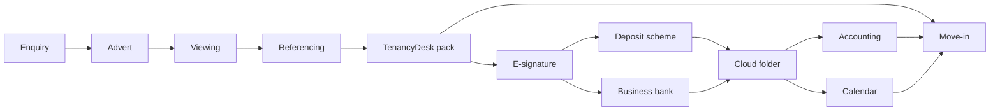

# The Agent's Toolbox

TenancyDesk does one job well: it writes the tenancy documents. It does not hold money, sign anything or chase dates — deliberately, so a one-person agency stays simple. These tools fill those gaps; all are well known in Britain and easy to set up.

**Start here.** Three things cover most days: an **e-signature tool**, a **cloud folder**, and a **deposit scheme** account. Add the rest when the gap hurts.

## The ten tools that matter most

| Job to be done | Recommended tool(s) | Roughly what it costs | How it connects to TenancyDesk |
| --- | --- | --- | --- |
| E-signature | [Signable](https://www.signable.co.uk), [DocuSign](https://www.docusign.co.uk), Adobe Acrobat Sign | Free trial, then a cheap monthly fee | Upload the `.docx` pack to your e-sign tool |
| Deposit protection | [TDS](https://www.tenancydepositscheme.com), [DPS](https://www.depositprotection.com), [MyDeposits](https://www.mydeposits.co.uk) | Free (custodial); insured schemes charge per deposit | TenancyDesk drafts the prescribed information |
| Client money protection & redress | [Client Money Protect](https://www.clientmoneyprotect.co.uk), RICS, [The Property Ombudsman](https://www.tpos.co.uk), [Property Redress Scheme](https://www.theprs.co.uk) | Typically a few hundred pounds a year each | Nothing — legal memberships |
| Referencing, right to rent & credit | [HomeLet](https://www.homelet.co.uk), [Let Alliance](https://www.letalliance.co.uk), [Goodlord](https://www.goodlord.co.uk); [Yoti](https://www.yoti.com) for ID | Priced per tenant check | Check first, then TenancyDesk writes the pack |
| Accounting / rent ledger | [Xero](https://www.xero.com), [QuickBooks](https://quickbooks.intuit.com), [FreeAgent](https://www.freeagent.com) | Cheap monthly fee per company | Enter the tenancy once, from the pack |
| Cloud file storage | [Google Drive](https://workspace.google.com), [OneDrive](https://www.microsoft.com/microsoft-365), [Dropbox](https://www.dropbox.com) | Free tier usually enough | Save each pack into the tenant's folder |
| Email & WhatsApp comms | Gmail or Outlook; [WhatsApp Business](https://business.whatsapp.com) | Free tier; cheap monthly fee per mailbox | You send the pack from your mailbox |
| Banking & payment reconciliation | [Starling Business](https://www.starlingbank.com), [Tide](https://www.tide.co.uk), [Monzo Business](https://monzo.com); [GoCardless](https://gocardless.com) | Often free; Direct Debit per collection | TenancyDesk never touches money |
| Compliance reminders | Google or Outlook Calendar; Landlord Vision or Goodlord | Free | Flags pack dates only |
| Property management CRM | [OpenRent](https://www.openrent.co.uk), [Arthur Online](https://www.arthuronline.co.uk), [Alto](https://www.alto.co.uk) | Free to advertise on some; monthly fee | CRM holds the pipeline; TenancyDesk writes the paperwork |

## E-signature

**Why you need it.** Posted contracts get lost; e-signature records who signed and when.

**Easy option.** Signable is built for small UK agencies and needs no training; DocuSign is the best-known name.

**If you're already using Adobe Acrobat,** signing may be included — check first.

**In TenancyDesk:** it exports each document as `.docx` and `.html` (print to PDF) for your e-sign tool. It does not sign or send anything.

## Deposit protection

**Why you need it.** Most deposits must be protected in an approved scheme within 30 days, with prescribed information for the tenant. Mistakes can cost several times the deposit.

**Easy option.** All three schemes are simple websites; custodial schemes hold the money and are free to use, insured ones charge per deposit.

**If you're already with TDS or DPS,** use one scheme for every tenancy.

**In TenancyDesk:** it drafts the prescribed information. It does not protect deposits or issue certificates.

## Client money protection & redress

**Why you need it.** Agents in England must belong to a client money protection scheme and a redress scheme — memberships, not software.

**Easy option.** Client Money Protect suits small agencies; for redress, choose The Property Ombudsman or the Property Redress Scheme.

**If you're already with RICS or Propertymark,** CMP may come with membership.

**In TenancyDesk:** nothing. Keep certificates in your cloud folder and name the memberships in the welcome pack.

## Referencing, right to rent & credit checks

**Why you need it.** You need to know a tenant can pay, and right to rent must be checked first.

**Easy option.** HomeLet and Let Alliance run affordability, credit and employer checks in one order.

**If you're already using Goodlord,** referencing is built in.

**In TenancyDesk:** it puts the tenant's details into the documents. It does no checks, so reference first.

## Accounting & rent collection

**Why you need it.** You need a clean record of rent in, deposit held and fees charged.

**Easy option.** Xero is the friendliest and connects to most UK banks; ask your accountant.

**If you're on QuickBooks or FreeAgent,** stay put — one ledger is the point.

**In TenancyDesk:** it writes dates and rent into the documents. It keeps no ledger, invoices nothing and holds no money.

## File storage & backups

**Why you need it.** Every tenancy needs one folder you can open in two years: application, checks, signed papers.

**Easy option.** Google Drive or OneDrive, one folder per property, then a dated subfolder per tenancy.

**If you're already paying for Microsoft 365,** use OneDrive — storage is included.

**In TenancyDesk:** it generates the documents; where they live is your choice.

## Communication

**Why you need it.** Tenants ask questions by email and WhatsApp; answering from a personal number gets messy.

**Easy option.** A professional mailbox plus the free WhatsApp Business app, with business hours and two saved replies.

**If you're already on Gmail or Outlook,** add the business name and signature.

**In TenancyDesk:** it drafts a cover message for email or WhatsApp, but sends nothing.

## Compliance calendar

**Why you need it.** Gas safety, electrical checks, alarms and licensing are date-driven and easy to forget until a tenant complains.

**Easy option.** One shared calendar with recurring entries and two reminders each; file the certificate the same day.

**If you're already using a CRM** that tracks certificates, let it.

**In TenancyDesk:** it flags a pack's key dates — deposit deadline, written statement, next gas and EICR check — but sends no reminders.

## Payments

**Why you need it.** Rent should arrive by standing order or Direct Debit, so you are not chasing transfers.

**Easy option.** A business account with a bank feed into your accounting software, plus GoCardless for Direct Debit.

**If you're already with a high-street bank,** ask for a bank feed.

**In TenancyDesk:** it processes and holds no payments. It writes rent and payment terms into the documents only.

## Property management software

**Why you need it.** Past a handful of properties you want one place for pipeline, maintenance and statements.

**Easy option.** OpenRent is simple for advertising; Arthur Online and Alto are the usual small-agency CRMs.

**If you're already on a CRM,** keep TenancyDesk as the document writer beside it.

**In TenancyDesk:** it does not replace a CRM. It writes the pack; the pipeline stays where it lives.

## How it all hangs together

1. **Enquiry** by phone, email or listing site — log it in your pipeline.
2. **Advertise** on your listing site or OpenRent.
3. **Viewing.** No tools needed.
4. **Application** taken; order **referencing** and the right to rent check.
5. **Agree** the move-in date and rent — what TenancyDesk needs.
6. **TenancyDesk writes the full pack:** agreement, statement of terms, deposit information, notices, inventory, guarantor deed, right to rent checklist, welcome pack.
7. **Upload it to your e-signature tool.**
8. **Deposit and first rent** arrive; you **protect the deposit** and issue the certificate.
9. **Signed papers and checks** go into that tenancy's cloud folder.
10. **Enter the tenancy** in your accounting software; set calendar reminders.
11. **Move-in day:** welcome pack and keys go out by email or WhatsApp.

Plain text version: enquiry → advert → viewing → referencing → **TenancyDesk writes the pack** → e-signature → deposit scheme and bank → cloud folder → accounting and calendar → move-in.

## What we deliberately left out

- **No CRM lock-in.** Your documents are just files, so you can switch systems whenever you like.
- **No database to run.** One local file to copy as a backup; templates are plain Markdown.
- **No AI training on your data.** Your details write your documents, not somebody else's model.
- **No per-tenant cloud costs.** It runs on your own machine, so a tenth tenant adds no bill.
- **No custom software to maintain.** Nothing needs a developer on retainer.

Complexity you do not need is a cost you cannot see until it breaks.

## If you only do three things

- [ ] Set up **one cloud folder per property**, with a dated subfolder per tenancy.
- [ ] Open **one deposit protection scheme** account and bookmark its certificate page.
- [ ] Choose **one e-signature tool** and send your next pack through it.

## Costs at a glance

| Band | What belongs here | What to expect |
| --- | --- | --- |
| Free / free tier | Cloud storage, WhatsApp Business, email, calendar | Free, with limits |
| Cheap (under ~£50/month) | E-signature, accounting software, business banking | A cheap monthly fee per tool |
| Only when you grow | CRM, referencing accounts, insured deposit scheme | Priced per tenant check or per property |

Prices change — check the provider's own site before you commit.

> TenancyDesk does not endorse any specific provider; these are starting points. Always check current pricing, contracts and data-protection terms yourself.
